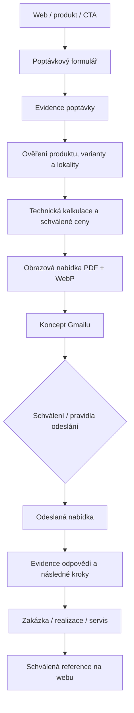

# MLŽIDLA.cz — jak funguje web a celý pracovní workflow

> Stav dokumentace: 7. 11. 2026. Tento dokument popisuje ověřené části repozitáře a navržené procesy. Označení **NAVRHOVÁNO** znamená, že integrace nebo automatizace není potvrzena jako funkční.

## 1. Účel a hranice systému

MLŽIDLA.cz prezentuje designové nerezové mlžné instalace pro města, obce, parky, školy, sportoviště a eventy. Cesta zákazníka: **inspirace → prostor/problém → vhodný produkt → technické možnosti → realizace → nezávazná poptávka**.

Značka: prémiový architektonický vzhled, produkt v reálném prostoru, lidé jako měřítko, jemná realistická mlha, přesná geometrie konstrukce. Nevymýšlet reference, certifikace, měření, tlakové parametry ani ceny.

## 2. Technické fungování webu (ověřeno v repozitáři)

- Frontend: React + Vite; zdrojové stránky v `src/pages/`, komponenty v `src/components/`, hlavní aplikace `src/App.jsx`, styly v `src/index.css`.
- Integrace s Base44: SDK `@base44/sdk`, konfigurace a entity v `base44/`; skutečné záznamy produktů, médií a poptávek je nutné kontrolovat v příslušných entitách, nikoli odvozovat jen ze souborů.
- Obsah a statická média: `content/`, `data/`, `public/`; konkrétní zdroj pravdy vždy ověřit pro danou stránku.
- Build: `npm ci && npm run build`. Skript spouští Vite, optimalizaci animací, generování produktových náhledů, SEO prerender a přípravu publikační složky. Bez ffmpeg se některé video/GIF kroky přeskočí.
- SEO: `scripts/prerender-seo.js`, metadata a sitemap kontrolovat po každém zásahu do rout.
- Produkční doména: `https://mlzidla.cz`; Base44 app ID: `6a3ee88c10959cd3588c4d68`.

**Pozor:** starší `ARCHITECTURE.md` uvádí MQTT, PostgreSQL, Grafanu a další služby jako architektonický náčrt. Jejich skutečné nasazení nebylo tímto auditem prokázáno. SUPLA prezentace na webu sama o sobě neprokazuje živé propojení se zařízeními.

## 3. Produktový katalog a média

Každý produkt má mít vlastní kartu a detail: správný název, účel, prostor použití, ověřené rozměry/materiál, fotografie odpovídající skutečnému tvaru, počet a polohu trysek, provozní podmínky, varianty osazení, volbu SUPLA a CTA na poptávku.

- Galerie nesmí míchat cizí produkty. Například LINEA AVENUE zobrazuje pouze varianty LINEA, nikoli BENDY.
- Vizualizace propojit s odpovídajícím produktem přes slug/identifikátor a schválený mediální záznam. Nestačí obrázek pouze nahrát do administrace.
- Tři doporučené režimy mlžení zobrazit **jen po technickém schválení**. Parametry tlaku, spotřeby a počtu trysek nesmí být generované odhadem.
- LINEA AVENUE: vícekusová sestava podél pěší trasy; výchozí specifikace 4 trysky na jeden sloupek, celková spotřeba = počet sloupků × spotřeba sloupku při zvoleném provozním režimu. Konkrétní průtok vyžaduje ověřený údaj trysky a tlaku.
- Zákazník může poptat konkrétní produkt a konfiguraci; formulář má převzít produkt/variantu a nejprve se ptát na typ prostoru a lokalitu, až pak na technické detaily.
- Veřejná galerie nesmí zobrazovat interní nebo neschválené vizualizace. Zachovat originální geometrii a nepřidávat vodoznaky.

## 4. Obchodní workflow (cílový proces)

**Cílové propojení, nikoli potvrzená plně automatická synchronizace:** Google Drive (ceník „Kalkulace 2026“, produktové fotografie, PDF), Canva (schválená šablona), obchodní Gmail, ChatGPT Sites (obchodní centrum), Base44 (web a administrace). Každá nabídka má obsahovat odkaz na archivovaný soubor, datum, příjemce, stav odeslání a odpověď. Zabránit duplicitám.

**Ochrana dat:** interní ceny, obchodní kontakty, zákaznická dokumentace a stav zakázek nesmí být veřejně dostupné bez řízení přístupu. Klientský portál vyžaduje autorizaci a oddělení dat zákazníků.

## 5. GitHub a Base44 — skutečné napojení

- GitHub: `jakub1duch-a11y/ml-idla-ml-tka-pro-m-sta-obce-a-ve-ejn-parky`.
- Ověřeno 7. 11. 2026: Base44 GitHub spojení **active**, webhook **active**, automatický import změn z GitHubu **zapnutý**.
- Base44 automaticky ukládá změny do připojeného repozitáře. Automatický import z GitHubu je závislý na dostupnosti editoru a může mít provozní omezení; neznamená to automaticky úspěšné nasazení.
- `.github/workflows/validate-build.yml`: `npm ci` a `npm run build` pro pull requesty a relevantní změny v main.
- `.github/workflows/deploy-base44.yml`: produkční deploy při relevantních změnách v main nebo ručně; vyžaduje GitHub secret `BASE44_API_KEY`. Pokud chybí, workflow pouze vypíše upozornění a nenasadí.
- **Známý otevřený problém:** Base44 vracel stav aplikace `error`, i když lokální `npm run build` prošel. Před prohlášením „nasazeno“ je nutné ověřit workflow run, aktuální verzi a veřejné produktové URL.

### Bezpečný postup pro každou změnu

1. Načíst aktuální main a ověřit stav GitHub/Base44.
2. Založit `feature/...` nebo `docs/...` větev; nikdy nepracovat přímo na main.
3. Upravit pouze potřebné soubory a schválená data; přidat krátký záznam změn.
4. Spustit `npm ci`, `npm run build` a podle rozsahu lint, typecheck a testy.
5. Vytvořit PR, prověřit CI a preview na desktopu i mobilu, galerii, CTA, SEO a oprávnění.
6. Po schválení merge; ověřit produkční deploy, načtení nové verze a konkrétní veřejné URL.
7. Při selhání vrátit poslední ověřenou verzi; nevydávat lokální úspěch buildu za nasazení.

## 6. ChatGPT, Canva, Google a další integrace

| Systém | Úloha | Stav / pravidlo |
|---|---|---|
| ChatGPT | Zadání, audit, návrhy textů, analýza, koordinace | Pro změny používat připojené nástroje; odpověď v chatu není sama o sobě změna webu. |
| Base44 | Web, administrace, produktová data | Připojeno ke GitHubu; publikování ověřovat zvlášť. |
| GitHub | Zdrojový kód, historie, PR, CI/CD | Připojeno; automatická synchronizace zapnuta. |
| Google Drive / Workspace | Podklady, ceny, fotografie, dokumentace | NAVRHOVÁNO: jednotné mapování složek, oprávnění a ID souborů. |
| Gmail | Koncepty, odeslané nabídky, reakce | NAVRHOVÁNO: synchronizace s evidencí poptávek a auditní stopou. |
| Canva | Schválené vizuální šablony nabídek | NAVRHOVÁNO: generování jen z ověřených cen a fotografií. |
| ChatGPT Sites | Interní obchodní dashboard, mapa kontaktů | NAVRHOVÁNO: bezpečná synchronizace; neveřejná zákaznická data. |
| Gemini / Google Flow / Colab / Excalidraw | Doplňkové generování, analýza, diagramy | Volitelné; žádné propojení není tímto dokumentem ověřeno. |

## 7. Správa rolí a pravidla kvality

- **Marketing:** schválené vizuály, texty, reference; nikdy nepřepisovat technické parametry bez ověření.
- **Technik:** geometrie, trysky, tlak, filtrace, spotřeba, kotvení, provoz, servis a bezpečnost.
- **Obchod:** cenová kalkulace z aktuálního zdroje, schválená nabídka, archiv a stav komunikace.
- **Správce webu:** PR, kontrola oprávnění, nasazení a rollback.
- **AI agent:** může připravit a ověřit návrh; nesmí vydávat neověřené nasazení, ceny, certifikace či reference za fakta.

## 8. Kontrolní seznam před vydáním

- [ ] Správné obrázky, produkt a geometrie na každé kartě.
- [ ] Technické parametry a varianty mlžení doložené zdrojem.
- [ ] Poptávka předává správný produkt, variantu a kontakt.
- [ ] Mobilní UX, kontrast, rychlost, dostupnost.
- [ ] SEO titulky, canonical, sitemap, žádné omylem veřejné interní stránky.
- [ ] CI build a preview bez chyb.
- [ ] Produkční verze a konkrétní stránky ověřeny po merge.
- [ ] Archivace změn a možnost návratu.

## 9. Podklady a další rozvoj

Tento standard vychází ze zadání `Web skill Update Mlzidla.pdf`, `md-vylepseni produktu -skill mlzidla update.pdf` a `ukoly-mlzidla-dnes.txt` (7. 11. 2026). Návrhy na klientský portál, pronájem pro eventy, bezpečnostní stránku a mapu realizací jsou backlog; jejich existence v zadání neznamená, že jsou dokončené. Každý další krok musí mít vlastní PR a kontrolu dat i práv.
