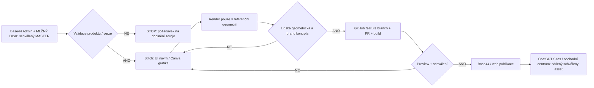

# MLŽIDLA.cz – závazná ochrana produktové geometrie a značky (Stitch / Canva / Base44 / GitHub / Sites)

**Stav:** technické zadání a kontrolní standard, ne prohlášení o automaticky dokončené integraci.
**Platnost:** veřejný web, administrace Base44, produktové galerie, 3D/AR, animace, video, poptávky, nabídky v Canvě, vizuály Google Stitch, ChatGPT Sites a obchodní centrum.

## 1. Autoritativní zdroje (pořadí)
1. **Produktový záznam v administraci MLŽIDLA.cz / Base44** se správným `slug`, verzí provedení a vazbou na jednoznačně schválenou MASTER referenci (`visual_master_reference_url`, `visual_master_verified`) a na schválenou galerii.
2. **Technické podklady a výkresy konkrétní verze produktu** na MLŽNÉM DISKU; sdílený registr `src/lib/driveProductMasterRegistry.js`. Nezaměňovat rodiny ani výrobní verze.
3. **Schválené firemní fotografie, videa, CAD a 3D** se známým původem, rozměry a právy k použití.
4. **Oficiální logotyp a barvy** existujícího webu a komponent `src/components/layout/Logo.jsx` + `src/components/brand/MlzidlaLogoSvg.jsx`, příslušný brand manuál a schválená Canva šablona. Logo nikdy nevymýšlet ani nerenderovat text-to-image.
5. Google Stitch, Canva a generativní obrazové nástroje smějí **navrhovat rozhraní, grafické vrstvy a okolní scénu**, ne určovat konstrukci produktu.

Pokud podklad chybí, `slug` je nejednoznačný nebo MASTER není ověřený, **STOP: nevytvářet klientský produktový vizuál**, nezařadit do galerie ani automaticky publikovat. Nepoužívat podobný produkt jako náhradu.

## 2. Přesná geometrie – povinný checklist
- Produkt a jeho verze odpovídá jednoznačnému `slug` v administraci. Nezaměnit LINEA, LINEA CE, LINEA AVENUE, BENDY/STÉBLO, GATE, OSTREV, MRAK, AURA nebo jiné modely.
- Stejný počet kontinuálních trubek, ramen a napojení; **stejná topologie, proporce, průměry/jekly, orientace, poloměry a úhly ohybů**, výška i rozměry v měřítku.
- Stejný počet a **poloha, orientace i směr** skutečných trysek; mlha vzniká **výhradně na ověřených tryskách**. Nevymýšlet tlak, průtok, velikost kapek ani dosah.
- Původní materiál, nerezový povrch, ukončení, patky a skryté kotvení. Nevymýšlet přídavné sloupy, podpěry, hadice ani spojení.
- U sestav (DUO, GATE, LINEA AVENUE, ALEJ) se mění **pouze počet, orientace a rozteč schváleného shodného kusu**. Přepočet trysek/spotřeby pouze z údajů konkrétní varianty, nikoliv odhadem obrázkového generátoru.
- Když nejde ověřit třeba zadní část konstrukce nebo přesné osazení trysek, požádat o další referenci; výstup zůstane označen **„Koncept – geometrie neověřena“**.

**Příklady:** LINEA AVENUE obsahuje jen stejné prvky LINEA, ne BENDY ani LINEA CE; čtyři trysky na jeden prvek pouze pro variantu potvrzenou v aktuálním produktovém záznamu. GATE nemá libovolné podpěrné nohy a oblouk nesmí změnit svůj skutečný charakter. Tvar není volný kreativní námět.

## 3. Logo a vizuální identita
- Používat **originální existující logo** ze značkových souborů webu; komponenty nevykreslovat alternativním AI logem. Nechat logo jako oddělenou SVG/UI vrstvu, nikdy ne jako součást generované fotografie.
- Použít stávající brand tokeny webu (navy/cyan/white/mist), schválenou typografii a značkové šablony v Canvě; jednotný header, footer, CTA, karty a administraci.
- Obchodní centrum ChatGPT Sites: stejné originální logo, paleta a typografie; odlišit interní rozhraní od veřejného webu. Nezveřejňovat interní ceny, kontakty, nabídky ani dokumentaci.
- Slogany, certifikace, měření chladicího účinku a reference **jen doložené**; bez vymyšlených technických parametrů.

## 4. Workflow a synchronizace

- Návrh, schválený výstup a skutečná realizace jsou **odlišné stavy**. Metadata: produkt `slug`, varianta, `masterReferenceURL`, zdroj, schvalovatel, datum, stav, cílový kanál.
- Automatizace smějí synchronizovat schválené soubory a komponenty, **nikoliv automaticky schvalovat generovaný tvar**. Přímé API/MCP propojení se Stitch musí být ověřeno; bez něj použít export do vývojové větve.
- Aktualizace originální MASTER reference musí vyvolat revizi závislých vizualizací. Staré obrázky znovu nepublikovat bez srovnání.
- Nesahat přímo do `main`; mít feature branch, testy, PR, preview, geometrické srovnání a schválení.

## 5. Kontrola návrhů vytvořených v tomto chatu
Předchozí AI obrázkové návrhy webu jsou **pouze schémata layoutu**. Obsahují smyšlené či neověřené produkty, zobrazení trysek a technické hodnoty. **Zákaz** nasadit je jako produktové fotografie nebo technické listy. Pro schválený design vytvořit nové kompozice ze skutečných fotografií a ověřených produktových assetů.

## 6. Zajištění při vývoji
- Vstup generátoru má projít `validateProductForVisualization(product)` z `src/lib/driveProductMasterRegistry.js`.
- `isProductMediaAllowed` z `src/lib/productMediaGuard.js` kontroluje názvy médií, **samo o sobě ale nedokazuje geometrickou správnost fotografie**.
- Render zůstane čekat na kontrolu a `approved_for_presentation=false`; automaticky neoznačovat návrh jako `is_primary_for_variant`.
- Lidská kontrola porovná originální MASTER, obraz shora/zboku, počet ramen/trysek, orientaci a velikost, logo a branding, mobilní UX i technická tvrzení. Bez tohoto kroku nepublikovat.
