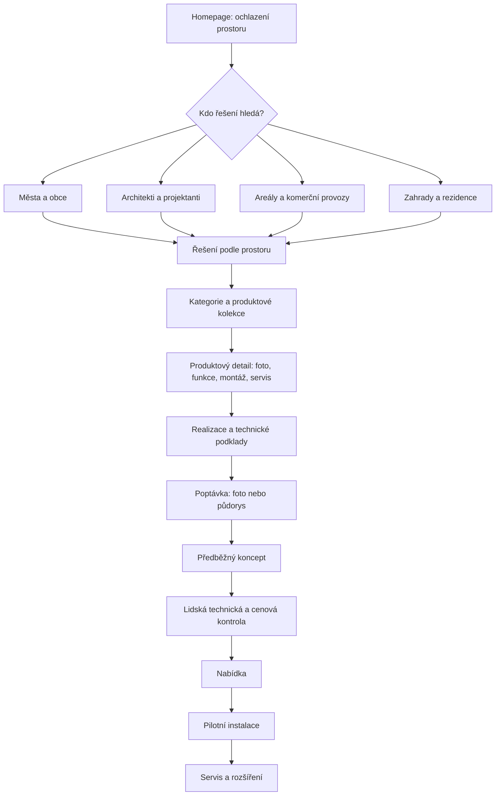
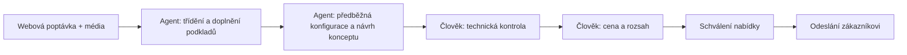

# MLŽIDLA.cz — jednotný návrh celého webu a plán AI agentů

**Stav dokumentu:** pracovní architektura pro audit a řízený redesign  
**Značka:** MLŽIDLA.cz  
**Autor veřejného webu:** Jakub z Mlžidla.cz  
**Hlavní obchodní cíl:** získat kvalitní poptávky na řešení ochlazování konkrétních prostorů; ne pouze zobrazovat izolované produktové stránky.

## 1. Zásadní technické zjištění

Projekt má nejméně dvě odlišné vrstvy, které se nesmí zaměňovat:

- Base44 pracovní projekt `6a3ee88c10959cd3588c4d68` používá Vite + React a Base44 SDK.
- Vercel eviduje projekt `mlzidlacz` s frameworkem Next.js, vlastními doménami `mlzidla.cz` a `www.mlzidla.cz`, a posledním deploymentem ve stavu READY.
- Veřejný web obsahuje produktové, kategoriální, referenční, obsahové a poptávkové URL.

**Breakdance 3.0 je WordPress plugin/builder.** Jeho MCP propojení přímo neupravuje současnou Vite/React nebo Next.js aplikaci. Přímé zapnutí Breakdance na stávajícím webu proto nelze bezpečně provést bez potvrzené WordPress instance a rozhodnutí, zda se web migruje. Do té doby je správná cesta sjednotit designový systém a návrh celé informační architektury v současném projektu; WordPress/Breakdance připravovat jako oddělenou staging/migrační větev, ne jako neověřenou změnu produkce.

## 2. Jedna informační architektura pro celý web

### Hlavní skupiny stránek

1. **Vstup a obchodní konverze:** homepage, městské ochlazování, chytré řešení prostoru, PPC/segmentové landing pages, poptávka a poděkování.
2. **Katalog a produktové rodiny:** katalog, městská mlžítka, zahradní mlžítka, mlžné brány, sloupková mlžítka, mlhoviště, atelierové prvky, jednotlivé produkty.
3. **Důvěra a důkazy:** reference, detail realizace, blog/novinky, video, technické fotografie a montážní podklady.
4. **Technologie a provoz:** jak to funguje, Smart ovládání, servis a údržba, ke stažení, ochrana zdraví, udržitelnost.
5. **Podpora a firemní obsah:** kontakt, o nás, podpora/FAQ, obchodní podmínky, GDPR.
6. **Soukromá část:** přihlášení, klientská sekce, můj projekt a administrační rozhraní — odděleně od veřejné navigace.

## 3. Společný design systém

### Značka a vizuální pravidla
- Primární paleta: hluboká námořnická modř, modrá/t tyrkysová mlha, bílá a neutrální technické plochy.
- Zachovat stávající rozpoznatelný znak a modro-tyrkysový charakter; barvy nepřebírat z cizích šablon.
- Typografie, spacing, rádiusy, stíny, okraje, focus states a animace mají být definované jednou jako globální tokeny.
- Veřejné texty nesmí návštěvníka zatěžovat interními názvy komponent ani zmínkami o AI službách.

### Sdílené komponenty
- globální hlavička, mega menu a mobilní navigace;
- hero a nadpis sekce;
- primární/sekundární CTA;
- produktová karta a produktová galerie;
- karta realizace, video a technický podklad;
- technické schéma Smart/SUPLA;
- proces spolupráce a formulář poptávky;
- footer jako orientační mapa webu.

### Pravidla pro produktovou pravdivost
- Upřednostnit skutečné fotografie, videa a ověřené podklady MLŽIDLA.
- Neměnit geometrii výrobků: počet trubek/ramen/trysek, proporce, materiál ani kotvení.
- Fotografie realizace, technický výkres a vizualizaci jasně rozlišovat.
- Specifikace, průtoky, ceny, instalaci a kompatibilitu uvádět pouze pro ověřenou konfiguraci.

## 4. Standard pro jednotlivé typy stránek

### Homepage
1. Jasné sdělení: co MLŽIDLA řeší a pro koho.
2. Hlavní CTA: „Pošlete fotografii nebo půdorys. Připravíme předběžný koncept řešení.“
3. Důkaz z reálných instalací a referencí.
4. Segmentace podle prostoru / zákazníka.
5. Jak mlžení funguje a jak se ovládá.
6. Výběr ověřených produktových rodin.
7. Proces od konceptu po servis.
8. Závěrečné CTA a plnohodnotný footer.

### Kategorie
- vysvětlit použití kategorie, ukázat reálné výrobky a pomoci zúžit výběr;
- filtrovat jen podle ověřených vlastností;
- mít viditelnou cestu k porovnání, detailu produktu a poptávce.

### Produktový detail
1. Hero s reálným produktem a jedním hlavním přínosem.
2. Galerie: reálné foto → použití v prostoru → detail konstrukce/kotvení → technický podklad → video.
3. Použití a varianty konfigurace.
4. Montáž, přívod vody, patka a servis podle konkrétního výrobku.
5. Ověřené technické parametry.
6. Reference a související produkty.
7. CTA na poptávku s předvyplněným produktem.

### Reference a blog
- každá reference má popis místa, cíle, skutečně dodaného produktu a relevantní fotografie/video;
- novinky propojit s produktovými detaily a řešením pro dané publikum;
- nepublikovat nepodložené úspory ani obecné sliby o účinku.

### Formulář poptávky
- první krok má být jednoduchý: typ prostoru, lokalita, stručný záměr, kontakt a volitelně foto/půdorys;
- jasně říct, co bude následovat;
- odeslaná poptávka vytvoří koncept a interní úkol, ne automaticky odeslanou závaznou nabídku.

## 5. AI agenti: bezpečný pracovní tok

### Role agentů
- **Webový auditor:** mapuje URL, šablony, duplicity, odkazy, CTA a mobilní stav.
- **Design systémový agent:** udržuje tokeny, sdílené komponenty a konzistenci napříč šablonami.
- **Obsahový/SEO agent:** navrhuje titulky, metadata, interní prolinkování a opravy textů.
- **Poptávkový agent:** třídí vstupy a připravuje koncept; nesmí samostatně potvrdit cenu ani odeslat závaznou nabídku.
- **QA agent:** kontroluje responzivitu, formuláře, přístupnost, odkazy, produktovou pravdivost a regresi.

### Přístup a schvalování
- používat oddělený staging a minimální potřebná oprávnění;
- před zápisem do produkce vytvořit zálohu/checkpoint a diff;
- změny v globálních šablonách schvalovat zvlášť, protože ovlivňují mnoho URL;
- nikdy nevkládat API klíče do klientského kódu;
- lidské schválení je povinné pro technické parametry, cenu, obchodní podmínky a finální odeslání nabídky.

## 6. Breakdance 3.0 + MCP: plán integrace

Breakdance 3.0 RC je určen pro WordPress. Podle aktuální dokumentace se agent připojuje v administraci WordPressu přes **Breakdance → Settings → Agents & MCP**, instalací/aktivací Agent Connector a povolením přístupu přes MCP. Universal Abilities poskytují širší možnosti správy WordPressu; tyto oprávnění je nutné omezit a otestovat.

### Předpoklady před připojením
1. Potvrdit, zda pro mlzidla.cz existuje WordPress instalace, kterou má Breakdance spravovat.
2. Pokud neexistuje, vytvořit pouze samostatné staging prostředí pro ověření — nepřepisovat současný web.
3. Ověřit kompatibilitu hostingu, WordPress/PHP požadavků a potřebných pluginů.
4. Připojit agenta přes oficiální průvodce a ověřit dostupné nástroje MCP.
5. Začít read-only auditem a jednou neprodukční šablonou; teprve poté zkoušet zápis.
6. Vytvořit globální šablony: header, footer, produktový detail, kategorie, reference, článek a poptávka.
7. Porovnat SEO URL, metadata, strukturovaná data, formuláře, redirecty, výkon a přístupnost s dnešním webem.
8. Migraci na WordPress povolit až po schválení výsledku a plánu návratu.

**Nedělat:** nepřipojovat MCP agenta s administrátorskými oprávněními k produkci jako první krok; nepřepínat DNS ani doménu; nepřevádět všechny stránky do Breakdance bez inventury URL a SEO mapy.

## 7. Kontrolní seznam celého webu

- [ ] Inventura všech veřejných URL a typů šablon
- [ ] Seznam kanonických URL, redirectů a případných duplicit
- [ ] Audit desktop / tablet / mobil pro každou šablonu
- [ ] Globální tokeny barev, typografie, spacingu a pohybu
- [ ] Jednotná navigace a footer
- [ ] Jednotná logika CTA a poptávkového formuláře
- [ ] Pravdivost produktových fotografií a technických parametrů
- [ ] Interní prolinkování mezi kategorií, produktem, referencí a poptávkou
- [ ] SEO metadata, sitemap, robots, schema a indexace
- [ ] Core Web Vitals, lazy loading a reduced-motion
- [ ] Funkčnost formulářů a předání do CRM
- [ ] Staging, checkpoint, diff, regresní testy a plán návratu
- [ ] Teprve po schválení nasazení do produkce

## 8. Doporučené pořadí realizace

**Fáze A — audit současného webu:** inventura URL, zdrojové aplikace, hosting, formuláře, SEO a existující šablony.  
**Fáze B — jednotný návrh:** design tokeny, navigace, CTA, komponenty a specifikace šablon pro celý web.  
**Fáze C — pilotní redesign v současném stacku:** homepage + kategorie + produktový detail + reference + poptávka jako jeden propojený celek.  
**Fáze D — Breakdance staging:** oddělený WordPress prototyp s MCP agentem; porovnat cenu, editovatelnost, SEO a provozní rizika.  
**Fáze E — rozhodnutí:** zůstat u současného stacku, nebo migrovat na WordPress/Breakdance. Produkční migrace je samostatné rozhodnutí, nikoli automatický důsledek instalace pluginu.

## 9. Akceptační kritéria

Redesign je hotový až tehdy, když návštěvník snadno pochopí nabídku, zvolí správnou cestu podle prostoru, přejde z kategorie na produkt, uvidí reálné důkazy a může bez zmatku odeslat poptávku. Vzhled, navigace, texty, CTA a technické komponenty se musí chovat konzistentně napříč všemi typy stránek — ne jen na homepage.
